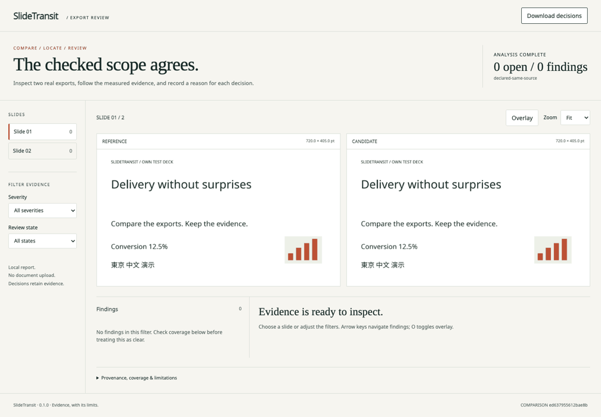

# SlideTransit

Local development candidate: **0.1.1rc1** adds strict report import/PNG boundaries and
explicit native raster grid coverage. It has not been published. See
[migration notes](docs/migration-0.1.1rc1.md) and the
[fresh export / independent review runbook](docs/external-pilot.md).

**Compare real presentation exports and locate delivery regressions.**

SlideTransit takes one source PPTX and two **already exported PDFs**, measures text,
position, wrapping and pixels, and produces an offline HTML/JSON evidence report.
Open a finding, inspect both crops, record a reason, and export a revision-bound
decision. Your presentation stays on your machine.

[Static sample](https://mikonyaa.github.io/slidetransit/) ·
[Download v0.1.0](https://github.com/mikonyaa/slidetransit/releases/tag/v0.1.0) ·
[Comparison model](docs/comparison-model.md) · [Known limits](docs/limitations.md)



The recording uses our own **documented source mutation**, genuinely exported by
LibreOfficeDev 26.8.0.0.alpha0. The clipped title is still in the PDF text layer.
This proves detection sensitivity; it does **not** demonstrate a defect between
two exporters of an unchanged source. A repeat-export control has no findings.

## Why compare exports?

A PPTX can look different after delivery. Inspect the delivered PDFs instead of
asking a new renderer to predict what the author saw. Text extraction alone can
miss visible clipping; raster-only diff cannot explain content or position.
SlideTransit keeps those evidence channels independent and shows their coverage.

Pixel diff, bounding boxes, HTML reports and reviewer dispositions already exist.
The focus here is the complete author workflow: two supplied exports → localized
paired evidence → an explained decision → a repeatable artifact with provenance.
See the [measured office2pdf comparison and current baselines](docs/competitive-baseline.md).
No demand, time-saving or general superiority claim is made.

## Install the published wheel

Requirements: Python **3.13**, macOS or Linux, and network access to install the
pinned dependencies once. Runtime analysis is local. Office, LibreOffice, uv and
Node.js are **not** runtime requirements. PyPI publication is not part of this release.

```sh
python3.13 -m venv .venv
. .venv/bin/activate
curl --fail --location \
  https://github.com/mikonyaa/slidetransit/releases/download/v0.1.0/slidetransit-0.1.0-py3-none-any.whl \
  --output slidetransit-0.1.0-py3-none-any.whl
python -m pip install "$PWD/slidetransit-0.1.0-py3-none-any.whl"
slidetransit doctor
slidetransit demo --out demo-output --no-open
```

For a wheel downloaded in your browser, use
`python -m pip install /absolute/path/to/slidetransit-0.1.0-py3-none-any.whl`.
Open `demo-output/clipped/report.html` directly in your browser. The demo checks
`repeat=0`, `clipped=1` and `fixed=0`; its overall exit is 0 only when all expected
subcase results hold. **The clipped case remains failing.**

## Compare a pair

```sh
slidetransit --help
slidetransit --version
slidetransit init --dir sample
slidetransit compare --manifest sample/comparison.json --out report --no-open
# Expected exit 1: this packaged example intentionally has a clipped title.
slidetransit compare --manifest sample/repeat.json --out repeat-report --no-open
# Expected exit 0: complete checked scope with no unhandled findings.
```

Edit a copy of the manifest for your own deck. Paths, including spaces and Unicode,
resolve from the **manifest's directory**, not the shell's working directory.
The main mode is `declared-same-source`: supplied export source hashes must agree
with the source PPTX. A user declaration is not proof of the export chain.
Unknown exporter versions and provenance must remain explicitly unknown.
Notes/handouts are unsupported; specify the same slide range, hidden-slide policy
and source order for both exports. Do not claim correspondence after inserting a page.

Outputs are `report.json`, a bounded self-contained `report.html`, and an `assets/`
directory with original page rasters, diff masks and crops. HTML embeds everything,
opens from `file://`, and requests no CDN, JSON, fonts or telemetry. JSON refers to
the neighboring assets; keep them together when applying review decisions.
Input documents are read-only. Existing output directories are never overwritten.

Use `--json` for a machine summary. `--no-open` disables browser launch; noninteractive
and CI runs do not open browsers. Configurable thresholds are `--dpi`, `--pixel-delta`,
`--displacement-pt` and `--fail-on`. Significant settings and rule implementation
are included in the report fingerprint.

## Review a difference

Choose a slide/finding, inspect the marked reference and candidate regions, switch
overlay or zoom, and enter a **reason**. Accept that difference, or accept a bounded
region inside both pages covering at most 25%. Accepted findings stay visible.
The optional author is never filled automatically. Download decisions, then run:

```sh
slidetransit apply-review --report report/report.json \
  --decisions review-decisions.json --out reviewed --no-open --json
```

Input, rule/configuration, renderer or region changes make decisions `stale`.
They are retained but do not suppress findings. A region cannot hide page absence,
unresolved page correspondence or a parsing error. Acceptance is a reviewer choice;
it does not establish that the original difference was harmless.

Keyboard: left/right arrows navigate findings; **O** toggles overlay. All controls
also work with Tab. At narrow widths a reference/candidate switch replaces the pair.
Browser decisions are in memory until downloaded; the report does not silently save
your presentation content in browser storage.

## Exit codes

| Code | Meaning |
|---|---|
| 0 | Complete required-channel coverage; no open findings at configured severity |
| 1 | Open findings at threshold, including when coverage is also incomplete |
| 2 | Invalid input, I/O, resource limit, native worker failure or runtime error |
| 3 | Incomplete coverage with no established finding at threshold |
| 130 | Interrupted |

`analysisStatus` and findings are independent. Clear means agreement within the
declared, actually checked scope; it does not mean good slide design or Office parity.

## What v0.1.0 supports

Python 3.13; local macOS 26.7.1 ARM64 on an M4 and the CI matrix in
[ci.yml](.github/workflows/ci.yml) (Ubuntu 24.04 and macOS 15). A platform is confirmed
by its successful release-commit job, not by a badge or the word “portable.” The
local browser review uses Chromium 155 at 1440, 1024 and 390 px. No claim of Windows,
physical mobile Safari, native PowerPoint or Keynote export testing is made.

The primary case is the same page count and explicitly agreed order. Count mismatches
and detected exact-text reorders produce unresolved correspondence; per-page diffs
are withheld. Changed page sizes are not stretched. Coordinates use the displayed
CropBox/rotation with top-left origin in points. Four rotations and nonzero box origins
have raster-coordinate canaries. Supported text matching is horizontal Unicode;
other directions or missing text layers produce partial/incomplete required coverage.

Source object association requires a unique text anchor, a supported direct transform,
geometric agreement and one candidate. It is labelled **Likely source object**.
Duplicate/grouped/inherited anchors remain unattributed. Shape IDs are slide-part-local.
Optional attribution confidence is separate from PDF analysis coverage.

Clipping is conditional evidence, not a proven cause. Low intensity raster hints
remain visible; a changed digit has independent high-severity extracted-text evidence.
No elastic alignment hides object movement. No OCR, automatic PPTX edits, cloud
processing, AI score or promise of full font substitution diagnosis is included.

## Provenance and fixtures

`init` and installed `demo` ship genuine, small, own exports with actual source/PDF
SHA-256, commands, filter, exporter version and environment. `tests/fixtures/real`
contains 15 captured exports and 14 comparisons: repeat, fixed, clipping, text/image
deletion, CJK, wrap, font, symbol, displacement, duplicates, counts, aspect and noise.
Synthetic PDF edge cases are labelled unit fixtures and are not presented as exports.
PDF metadata is not used as proof of origin.

To regenerate the real corpus, supply Noto Sans, Noto Sans CJK SC and Liberation Serif
in a directory containing only legally embeddable fonts, and an installed `soffice`:

```sh
uv run --frozen python scripts/make_fixtures.py \
  --out work/re-exported --font-dir /absolute/path/to/open-fonts
```

The script owns each temporary exporter profile and its fontconfig cache; it does
not change Office, user fonts or global profiles. Newly generated bytes/hashes may
differ. Re-export was checked only on the accurately recorded local LibreOfficeDev
development build. Analysis does not need that exporter.

## Bounds and security

Default limits: 100 MiB/input, 5,000 ZIP entries, 32 MiB expanded XML, 128 MiB expanded
ZIP, 200 pages, 8 million pixels/page, 100,000 chars/page and 250,000 chars/PDF,
5,000 findings, 32 MiB report JSON, 64 MiB standalone HTML, 128 MiB total output and
180 seconds/analysis worker. Lower DPI or scope explicitly; excess is an error.
See [limits and security boundary](docs/limitations.md) and [SECURITY.md](SECURITY.md).

No arbitrary ZIP extraction, DTD/entities, external downloads, macros, imported HTML,
PDF actions or V8/XFA initialization. Native libraries run in an owned bounded
subprocess, **not an OS sandbox**. Reports contain document text/images and can be
confidential. Public examples are exclusively our own test materials.

## Development and final consumers

```sh
uv sync --frozen --all-groups
uv run --frozen ruff check .
uv run --frozen mypy src/slidetransit
uv run --frozen pytest tests/unit tests/integration
uv run --frozen python -m build
uv run --frozen python scripts/verify_release.py --dist dist
```

The consumer verifier creates separate venvs outside the checkout, installs the final
wheel and a wheel built from the final sdist, and executes doctor/init/compare/demo/
apply-review without editable install or `PYTHONPATH`. CI repeats this on both OSes.
The release publishes the downloaded artifact bytes of the successful exact-commit
Linux CI run; its manifest records the commit, environment, run and checksums. It is
an origin record, not a cryptographic attestation. [Verification](docs/verification.md).

For browser QA, install Playwright's Chromium in an isolated development environment,
or pass an existing executable; Playwright launches a separate owned profile:

```sh
uv run --frozen slidetransit demo --out work/browser-demo --no-open
uv run --frozen python scripts/verify_ui.py --demo work/browser-demo --out work/browser-qa
uv run --frozen python scripts/build_site.py --out site
```

Pages serves a ready-made sample. It does not analyze visitor PDFs or upload documents.
Deployment touches only this project subpath; no custom domain is used.

## License and later scope

[MIT](LICENSE) for the project and own artwork/decks; embedded open fonts retain their
OFL licenses. [Third-party notices](THIRD_PARTY_NOTICES.md) include PDFium components.

Possible P2 work: adapters for available exporters, broader validated text/source
mapping, batch comparisons, more confirmed platforms and optional PyPI/Homebrew
distribution. They are not implemented or promised in v0.1.0.
